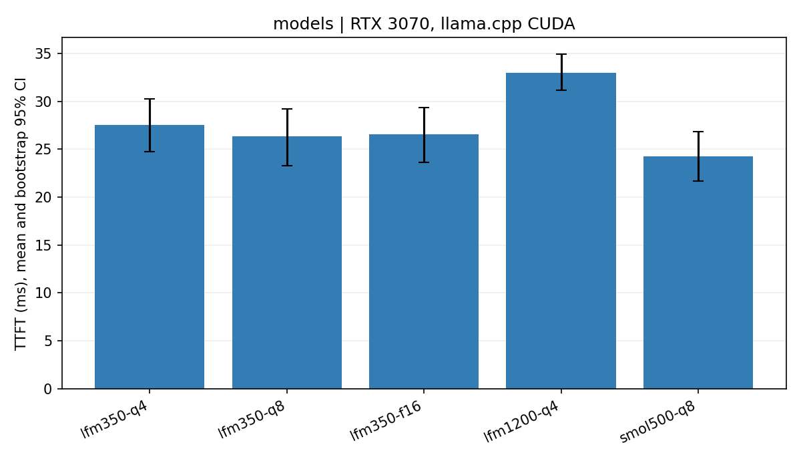
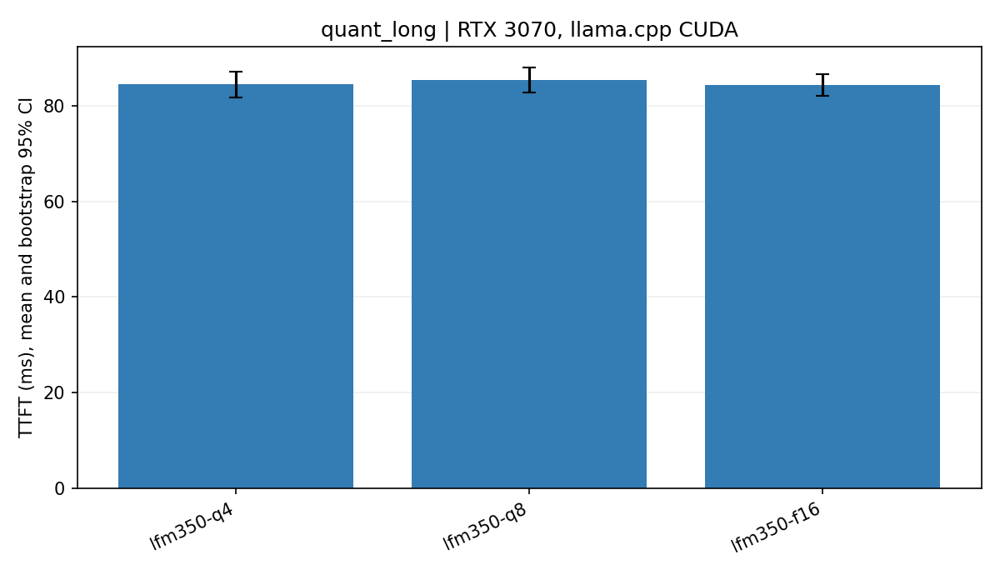
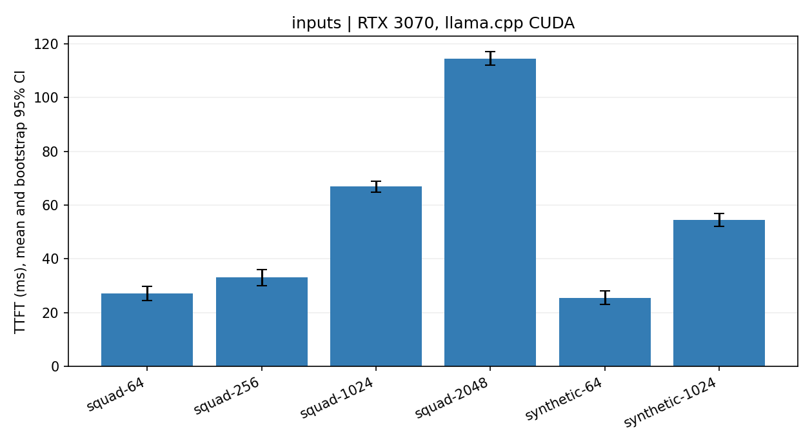
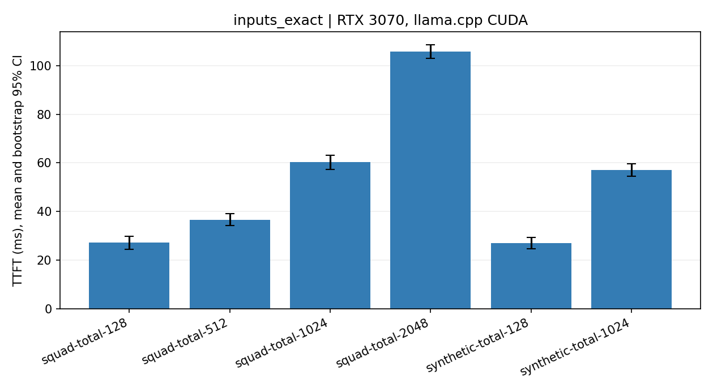
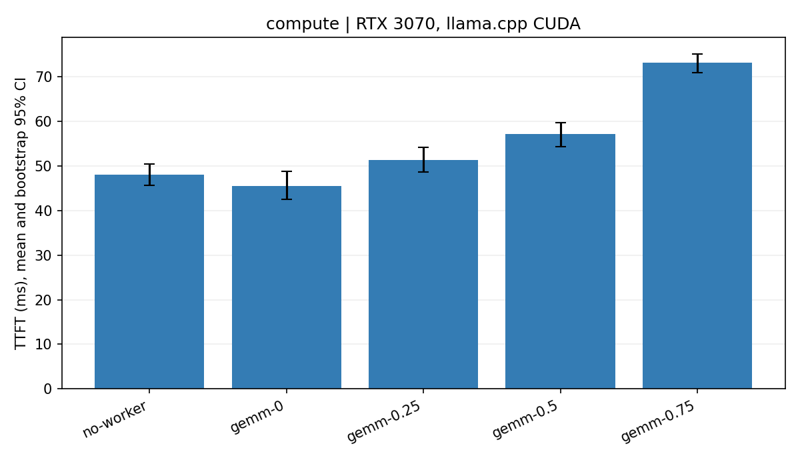
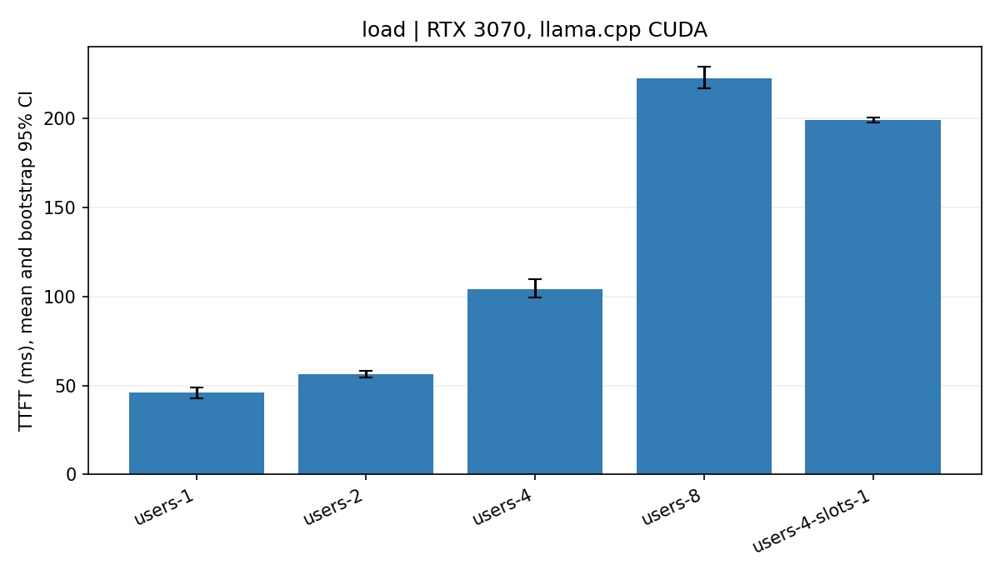
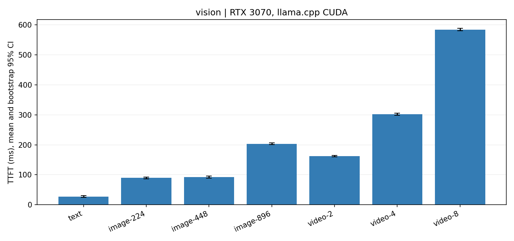
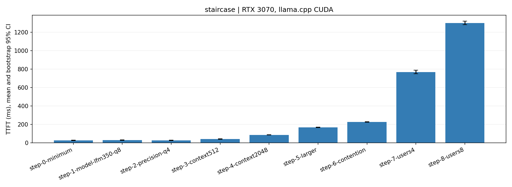

# Small-model TTFT inference lab

Completed on 2026-10-13: RTX 3070 (8 GiB), Windows, llama.cpp CUDA. **46 final configurations × 48 valid requests = 2,208 final measurements**, plus 40 pilot requests and 776 warm-ups; **3,024 requests total, zero failures, zero reused prefix tokens**. [Acceptance audit](results/validation.json).

**[中文完整报告与结论](docs/results-zh.md)** · [Raw measurements](results/requests.jsonl) · [Environment and hardware](data/environment.json)

The lowest observed final candidate mean was **SmolVLM2-500M Q8: 24.22 ms**. Illustrative controlled comparisons:

| Factor | Change | Mean TTFT (ms) |
|---|---|---:|
| Same-family model size | LFM2 350M Q4 → 1.2B Q4, short input | 27.50 → 32.98 |
| Actual total input length | 128 → 2048 tokens, same model | 27.12 → 105.83 |
| GPU contention | resident idle worker → 75% GEMM duty | 45.55 → 73.16 |
| Concurrent users | 1 → 8, fixed four server slots | 46.05 → 222.86 |
| Image resolution | 224 → 896, same visual model | 89.80 → 203.46 |
| Video frames | 2 → 8 at 224 pixels | 162.27 → 583.91 |

GPU contention is not another physical GPU. Visual QA uses reproducible synthetic scenes and ordered video frames. At matched total text tokens, dataset-content differences were inconclusive; quantization showed no stable TTFT advantage. The independent cumulative staircase rose from **26.82 to 1301.54 ms overall**, with a retained **2.11 ms decrease** at the Q8 → Q4 precision step. It is **not strictly monotonic**.

## Experimental contract

- At least **48 measured requests per configuration**, plus separate warm-up. Model loading and cold-start requests are excluded from steady-state TTFT and retained separately.
- Primary metric: monotonic wall-clock elapsed time from immediately before local HTTP request submission to the first **nonempty generated text** SSE delta. Headers, role-only deltas and keepalives do not count. First generated token and first visible text may differ; both are recorded where available.
- Same engine, greedy decoding, fixed seed, disabled prompt/KV prefix reuse, fixed output budget, paired sample IDs, fixed CPU threads and fixed context budget. Preserve failed/missing requests in the denominator.
- Separate one-factor comparisons for model, quantization, input length/dataset, modality/resolution/video frames, GPU contention, and concurrent users. One loaded model serves multiple users; weights need not be replicated.
- Use disjoint pilot data for functional checks, select the fastest **observed eligible configuration** in the 48-request model comparison, and remeasure it in an independent staircase. An observed minimum is not a proof of the global optimum.
- Present measured means, median/p95, sample spread and bootstrap confidence intervals. A staircase is an empirical, cumulative scenario; never discard a nonmonotonic result or conflate sorting with causality.
- GPU competition is a resource-contention proxy, **not another physical GPU or a guaranteed percentage of GPU compute**. Keep existing GPU power/clock settings unchanged. Log telemetry.
- Server prompt-processing timings are distinct from client TTFT. Any remainder includes queueing, preprocessing, scheduling, transport and streaming; it is not a direct measurement of queue time.

## Hardware and tested models

Detected GPU: NVIDIA GeForce RTX 3070, 8192 MiB; NVIDIA driver 610.60. Existing power ceiling: 154 W (driver-reported default 220 W). RAM: approximately 32 GiB. This is an interactive Windows desktop, so residual OS/display contention is a limitation.

Tested models, all below 7B:

| Model | Role | Weights |
|---|---|---|
| LiquidAI LFM2-350M | small text baseline and quantization comparison | Q4_K_M, Q8_0, F16 |
| LiquidAI LFM2-1.2B | larger text model, same family | Q4_K_M |
| HuggingFaceTB SmolVLM2-500M-Video-Instruct | same-model text/image/multi-frame video comparisons | Q8_0 language model + Q8_0 vision projector |

Liquid models are open-weight under the [LFM Open License](https://huggingface.co/LiquidAI/LFM2-350M); they are not described here as OSI-approved open source. SmolVLM2 is [Apache-2.0](https://huggingface.co/HuggingFaceTB/SmolVLM2-500M-Video-Instruct). Model size alone is not a FLOP count or a quality comparison. No answer-quality conclusion follows from these latency results.

## Data and reproducibility

Text: seeded selection from the public [SQuAD 1.1 development set](https://rajpurkar.github.io/SQuAD-explorer/). Packed/cropped context variants are explicitly labeled and not treated as original SQuAD accuracy evaluation. Synthetic controls isolate token length. Visual controls use reproducible original shape scenes and ordered video frames; they are not a representative real-world vision benchmark. Input manifests and hashes are published; model weights, runtime binaries and full third-party datasets are excluded.

Pinned runtime: [llama.cpp b11577](https://github.com/ggml-org/llama.cpp/releases/tag/b11577), CUDA 12.4 Windows build. See [server API documentation](https://github.com/ggml-org/llama.cpp/blob/b11577/tools/server/README.md). Revisions and verified model SHA-256 hashes are in [data/artifacts.json](data/artifacts.json).

When PyTorch 2.6.0+cu124 is already installed, preparation reuses its CUDA 12.4 DLLs and hashes each dependency. Otherwise it downloads the matching llama.cpp CUDA dependency archive. The CUDA GEMM competition experiment requires a CUDA-enabled PyTorch installation (this machine uses 2.6.0+cu124).

```powershell
python -m pip install -r requirements.txt
python scripts/prepare.py
python scripts/capture_environment.py
python scripts/test_measurement.py
python scripts/calibrate_compute.py
python scripts/benchmark.py --stage all
# Authorized repository maintainers may add --publish for incremental README updates.
# Or measure one stage: --stage models|quant_long|inputs|inputs_exact|compute|load|vision|staircase
python scripts/verify_results.py
python scripts/summarize_telemetry.py
python scripts/report.py
python scripts/write_chinese_report.py
```

## Completion

All eight final measurement stages and the disjoint pilot are complete. SSE regression, CUDA/model/vision functional checks, upstream model digests, actual full GPU offload, sample denominators, exact-stage token counts, output budgets, timing boundaries and cache state passed. GPU processes exited and the original power limit remains unchanged.

This public repository is updated after each completed measurement stage. Raw per-request records remain available alongside summaries, including negative results and limitations.

<!-- RESULTS:START -->
## Measured results

All times below are **milliseconds**, warm requests only. Pilot rows have 8 requests and are excluded from final conclusions. Final configurations target 48 paired requests in two randomized blocks. CI: seeded bootstrap; concurrent conditions resample whole waves. See [methodology](docs/methodology.md), [raw requests](results/requests.jsonl), [summary CSV](results/summary.csv), and [paired differences](results/paired-effects.csv).

### pilot

| Configuration | Valid / attempted | Mean | 95% CI | Median | p95 | Input tokens (mean) |
|---|---:|---:|---:|---:|---:|---:|
| lfm350-f16 | 8 / 8 | 18.97 | 14.75–24.54 | 15.65 | 31.02 | 91.12 |
| lfm350-q8 | 8 / 8 | 33.59 | 28.05–37.66 | 35.65 | 40.53 | 91.12 |
| lfm350-q4 | 8 / 8 | 29.33 | 22.82–35.48 | 31.87 | 40.36 | 91.12 |
| lfm1200-q4 | 8 / 8 | 29.00 | 22.00–35.99 | 28.39 | 40.36 | 91.12 |
| smol500-q8 | 8 / 8 | 30.41 | 24.46–35.13 | 31.44 | 39.26 | 92.50 |


### models

| Configuration | Valid / attempted | Mean | 95% CI | Median | p95 | Input tokens (mean) |
|---|---:|---:|---:|---:|---:|---:|
| lfm350-q4 | 48 / 48 | 27.50 | 24.71–30.25 | 27.37 | 40.79 | 93.27 |
| lfm350-q8 | 48 / 48 | 26.32 | 23.31–29.20 | 30.77 | 38.87 | 93.27 |
| lfm350-f16 | 48 / 48 | 26.54 | 23.63–29.30 | 27.28 | 39.65 | 93.27 |
| lfm1200-q4 | 48 / 48 | 32.98 | 31.15–34.91 | 34.99 | 39.50 | 93.27 |
| smol500-q8 | 48 / 48 | 24.22 | 21.69–26.84 | 25.43 | 38.21 | 94.19 |



### quant_long

| Configuration | Valid / attempted | Mean | 95% CI | Median | p95 | Input tokens (mean) |
|---|---:|---:|---:|---:|---:|---:|
| lfm350-q4 | 48 / 48 | 84.51 | 81.73–87.24 | 86.25 | 98.31 | 2072.12 |
| lfm350-q8 | 48 / 48 | 85.39 | 82.84–88.03 | 84.59 | 96.89 | 2072.12 |
| lfm350-f16 | 48 / 48 | 84.40 | 82.10–86.60 | 84.67 | 98.25 | 2072.12 |



### inputs
Original context-budget experiment: token-array repeat + text round-trip can merge tokens (especially the synthetic repeated sentence). Names are requested budgets, **not matched final token counts**. The actual counts below are retained. Use `inputs_exact` for strictly matched total input tokens.


| Configuration | Valid / attempted | Mean | 95% CI | Median | p95 | Input tokens (mean) |
|---|---:|---:|---:|---:|---:|---:|
| squad-64 | 48 / 48 | 27.22 | 24.51–29.74 | 28.20 | 41.46 | 94.19 |
| squad-256 | 48 / 48 | 33.16 | 29.96–36.10 | 35.94 | 46.08 | 286.19 |
| squad-1024 | 48 / 48 | 66.93 | 64.73–68.98 | 69.88 | 75.91 | 1054.19 |
| squad-2048 | 48 / 48 | 114.54 | 112.11–117.06 | 115.41 | 126.44 | 2078.19 |
| synthetic-64 | 48 / 48 | 25.43 | 23.05–28.01 | 26.20 | 39.61 | 86.94 |
| synthetic-1024 | 48 / 48 | 54.52 | 52.21–56.86 | 53.97 | 69.78 | 958.94 |



### inputs_exact

| Configuration | Valid / attempted | Mean | 95% CI | Median | p95 | Input tokens (mean) |
|---|---:|---:|---:|---:|---:|---:|
| squad-total-128 | 48 / 48 | 27.12 | 24.37–29.88 | 28.73 | 42.56 | 128.00 |
| squad-total-512 | 48 / 48 | 36.64 | 34.15–39.12 | 40.17 | 46.68 | 512.00 |
| squad-total-1024 | 48 / 48 | 60.36 | 57.39–63.17 | 65.26 | 72.23 | 1024.00 |
| squad-total-2048 | 48 / 48 | 105.83 | 103.02–108.54 | 110.95 | 117.73 | 2048.00 |
| synthetic-total-128 | 48 / 48 | 26.90 | 24.71–29.19 | 27.45 | 39.39 | 128.00 |
| synthetic-total-1024 | 48 / 48 | 57.13 | 54.50–59.64 | 56.16 | 70.12 | 1024.00 |



### compute

| Configuration | Valid / attempted | Mean | 95% CI | Median | p95 | Input tokens (mean) |
|---|---:|---:|---:|---:|---:|---:|
| no-worker | 48 / 48 | 48.08 | 45.61–50.54 | 50.09 | 58.70 | 542.19 |
| gemm-0 | 48 / 48 | 45.55 | 42.55–48.84 | 47.07 | 62.63 | 542.19 |
| gemm-0.25 | 48 / 48 | 51.39 | 48.72–54.23 | 53.83 | 65.11 | 542.19 |
| gemm-0.5 | 48 / 48 | 57.22 | 54.41–59.79 | 58.42 | 69.77 | 542.19 |
| gemm-0.75 | 48 / 48 | 73.16 | 71.02–75.14 | 73.57 | 84.59 | 542.19 |



### load

| Configuration | Valid / attempted | Mean | 95% CI | Median | p95 | Input tokens (mean) |
|---|---:|---:|---:|---:|---:|---:|
| users-1 | 48 / 48 | 46.05 | 43.01–49.10 | 44.26 | 61.20 | 542.19 |
| users-2 | 48 / 48 | 56.42 | 54.46–58.49 | 61.41 | 74.73 | 542.19 |
| users-4 | 48 / 48 | 104.21 | 99.53–109.86 | 125.15 | 134.94 | 542.19 |
| users-8 | 48 / 48 | 222.86 | 217.04–229.05 | 204.72 | 374.98 | 542.19 |
| users-4-slots-1 | 48 / 48 | 199.43 | 198.00–200.87 | 198.71 | 369.21 | 542.19 |



### vision

| Configuration | Valid / attempted | Mean | 95% CI | Median | p95 | Input tokens (mean) |
|---|---:|---:|---:|---:|---:|---:|
| text | 48 / 48 | 27.82 | 25.42–30.34 | 28.30 | 41.62 | 94.19 |
| image-224 | 48 / 48 | 89.80 | 87.02–92.73 | 90.74 | 104.54 | 153.00 |
| image-448 | 48 / 48 | 92.60 | 89.41–95.84 | 91.19 | 108.05 | 153.00 |
| image-896 | 48 / 48 | 203.45 | 200.32–206.31 | 202.88 | 220.91 | 352.00 |
| video-2 | 48 / 48 | 162.27 | 159.43–165.04 | 162.06 | 178.10 | 311.00 |
| video-4 | 48 / 48 | 302.13 | 298.91–305.44 | 303.41 | 319.53 | 599.00 |
| video-8 | 48 / 48 | 583.91 | 580.16–587.80 | 585.10 | 602.20 | 1175.00 |



### staircase

| Configuration | Valid / attempted | Mean | 95% CI | Median | p95 | Input tokens (mean) |
|---|---:|---:|---:|---:|---:|---:|
| step-0-minimum | 48 / 48 | 26.82 | 24.46–29.11 | 27.11 | 40.21 | 94.19 |
| step-1-model-lfm350-q8 | 48 / 48 | 29.49 | 26.46–32.34 | 34.29 | 41.59 | 93.27 |
| step-2-precision-q4 | 48 / 48 | 27.38 | 24.82–30.07 | 27.40 | 40.61 | 93.27 |
| step-3-context512 | 48 / 48 | 42.59 | 40.05–45.08 | 43.84 | 55.03 | 540.21 |
| step-4-context2048 | 48 / 48 | 87.57 | 85.03–90.23 | 87.42 | 99.74 | 2072.12 |
| step-5-larger | 48 / 48 | 167.82 | 165.37–170.26 | 171.99 | 176.13 | 2072.12 |
| step-6-contention | 48 / 48 | 227.52 | 224.81–230.10 | 231.81 | 238.47 | 2072.12 |
| step-7-users4 | 48 / 48 | 769.37 | 750.77–789.91 | 807.36 | 881.79 | 2072.12 |
| step-8-users8 | 48 / 48 | 1301.54 | 1282.92–1320.45 | 1179.41 | 1966.00 | 2072.12 |



## Observations and limits

Pilot selected **lfm350-f16**. Independent final model comparison minimum: **smol500-q8**, 24.22 ms. Subsequent factor tests use this final comparison minimum as their text baseline. The separate staircase remeasures it. This is the observed minimum among tested candidates, not a global optimum.

Staircase mean reversals: step-1-model-lfm350-q8 → step-2-precision-q4. Retained without filtering.

Input resolution and visual tokens may saturate at the model processor limit. Quantization may increase prefill overhead. GPU GEMM duty is not a hardware-equivalence claim. Concurrent results include server queueing and batching. Visual inputs are controlled synthetic scenes, not a real-world vision benchmark. No quality, FLOP-count, production-throughput or cross-GPU conclusion is established.

<!-- RESULTS:END -->

