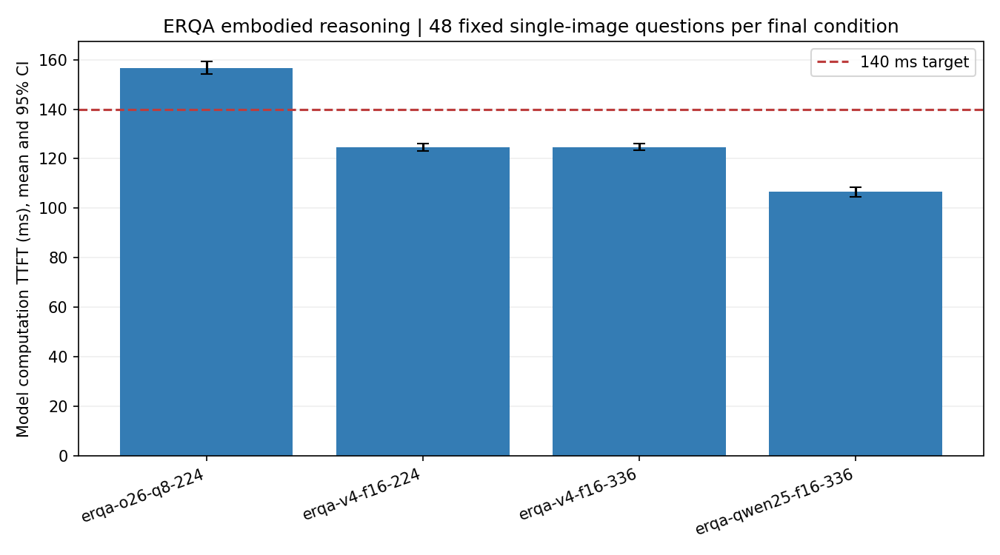

# ERQA 具身推理任务：完整模型首 token 计算时延

日期：2026-10-13（上海）。状态：complete，正式192条。

| 模型 / 视觉精度 | 面积预算 | 有效/尝试 | 首token均值 ms | 95% CI ms | p95 ms | 严格正确 | ≤140ms | 正确且≤140ms |
|---|---:|---:|---:|---:|---:|---:|---:|---:|
| MiniCPM-o-2.6 / 混合Q8 | 224 | 48/48 | **156.56** | 154.31–159.38 | 172.78 | 20/48 | 0/48 | 0/48 |
| MiniCPM-V-4 / F16 | 224 | 48/48 | **124.56** | 123.24–126.20 | 134.39 | 16/48 | 46/48 | 16/48 |
| MiniCPM-V-4 / F16 | 336 | 48/48 | **124.62** | 123.37–126.19 | 134.92 | 18/48 | 46/48 | 18/48 |
| Qwen2.5-VL-3B-Instruct / F16 | 336 | 48/48 | **106.61** | 104.55–108.52 | 118.49 | 16/48 | 48/48 | 16/48 |

这次使用真实公开的 [ERQA具身推理基准](https://github.com/embodiedreasoning/ERQA)，测试空间/物理关系、操作可行性和轨迹等场景理解。它与此前单色矩形任务分别统计，**不能用颜色问答140.25ms代替具身任务结果**。ERQA为离线感知/推理选择题，不执行机器人控制，也不证明动作策略、任务成功率或闭环实时性。

项目原有StreamingBench子集含18道Action Perception和2道Spatial Understanding，仅20道相关题且非专门机器人基准；因此新增ERQA固定48题以满足数十条样本要求。原始400题中只选单图片目，完整保留每题全部问题/选项，不按长度、难度、正确率或时延筛题：固定种子20261013打乱合格题，前48正式、后8预热、再8预试验。不同模型/分辨率使用同48题；每档两个24题块，配置顺序按块重新随机，各块另做8题独立预热。合格单图题数为287；正式题主要类型分布为 `{"Trajectory Reasoning": 14, "Action Reasoning": 13, "State Estimation": 5, "Pointing": 4, "Spatial Reasoning": 10, "Task Reasoning": 1, "Other": 1}`。原多标签分布另存清单，各标签计数不应相加为题数。

模型运行时b11577 CUDA12.4、RTX3070 8GB；语言均Q4_K_M；MiniCPM-o视觉为前述混合Q8组件，MiniCPM-V-4与Qwen2.5-VL-3B视觉为F16。因此跨MiniCPM-o与其他模型不只改变参数量/架构，还改变视觉精度，不能作单因素量化结论。MiniCPM-V-4的224/336比较仅改变客户端输入面积预算。每次完整执行视觉编码及语言prefill/首次采样，未拆分部署或缓存视觉特征。单槽4096、batch2048/ubatch512、4线程、温度0、种子固定、前缀缓存关闭并核验cache_n=0、最多4输出token，正常EOS。

主计时为内部 `prompt_ms`，排除权重加载、HTTP、客户端图片准备及进入槽位之前的排队；是运行时模型执行墙钟，不是纯CUDA内核之和。保留宽高比、面积上限224²/336²、尺寸向下对齐28、JPEG95；问题及全部选项不截短，只加 `Reply with exactly one letter, no other text.`。不同分辨率可能改变图中小字/箭头的可读性，须同时看正确率。处理器缩放可能使两档视觉token相同，实际token在CSV保留。

主表分母含全部正式尝试。严格正确要求唯一A–D字母（允许句点），格式错误/截断计错。≤140ms列统计全部题的延迟达标，最后一列同时要求答对；均值接近140ms不等于p95或每题均满足140ms。4token上限下的生成结束耗时如被截断，不称完整答案。CI为固定种子2000次bootstrap，小样本准确率不能外推完整ERQA排名。

模型区别：本报告中的MiniCPM-o2.6和MiniCPM-V-4生成文本；官方 [MiniCPM-RobotManip/RobotTrack](https://github.com/OpenBMB/MiniCPM-Robot) 是另一个面向机器人操作/跟踪的系列。RobotManip输出动作块，不能把其动作步耗时当文本TTFT；本次未声称运行RobotManip、RobotTrack或机器人仿真。官方不同硬件指标也不作为本机实测。

来源与复现：[原ERQA固定commit](https://github.com/embodiedreasoning/ERQA/tree/5bba488252c5b345a43335bfb9239b6bf12bd91c)，CC-BY-4.0，归属Embodied Reasoning QA / embodiedreasoning / Google DeepMind。[源Git blob及SHA256](../data/erqa-provenance.json)、[固定样本与图片哈希](../data/erqa-selected.json)、[逐请求](../results/embodied_erqa/requests.jsonl)、[汇总CSV](../results/embodied_erqa/summary.csv)、[验收](../results/embodied_erqa/validation.json)。未上传完整TFRecord、图片缓存或私人素材；从固定源下载后按Git blob核验。`python scripts/prepare_erqa.py`准备，`python scripts/run_erqa.py --assets <原MiniCPM素材目录>`测量，`python scripts/report_erqa.py`重建报告。
