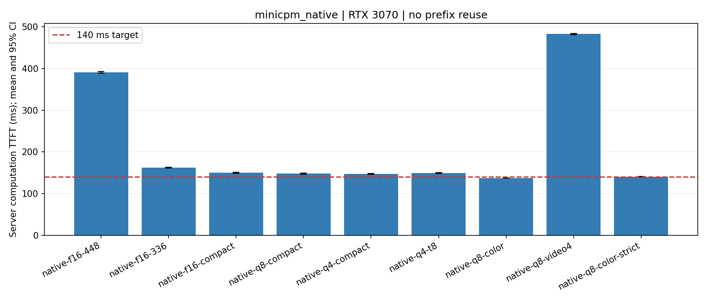
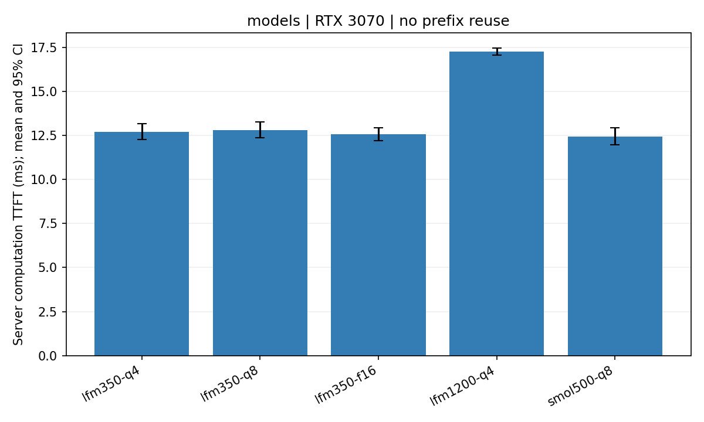
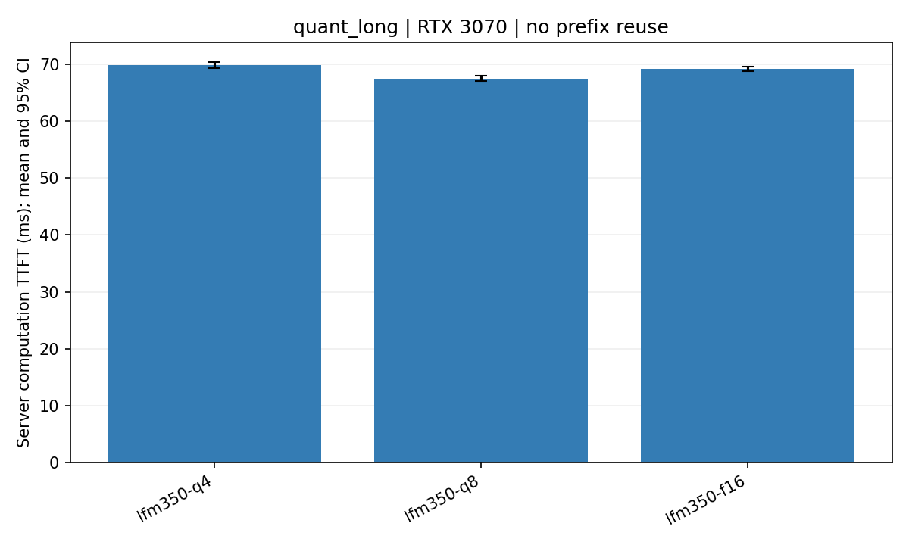
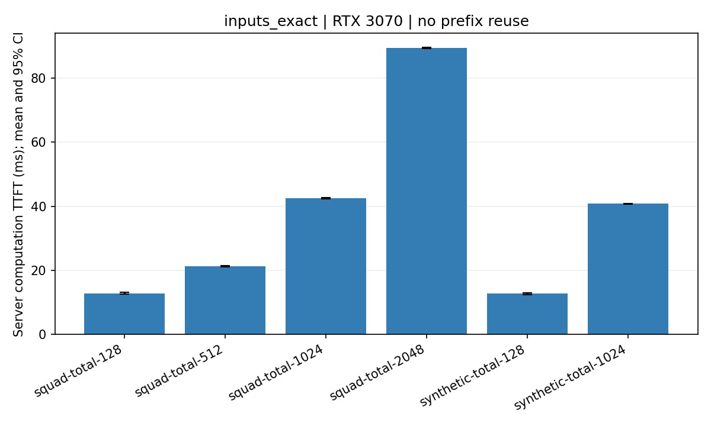
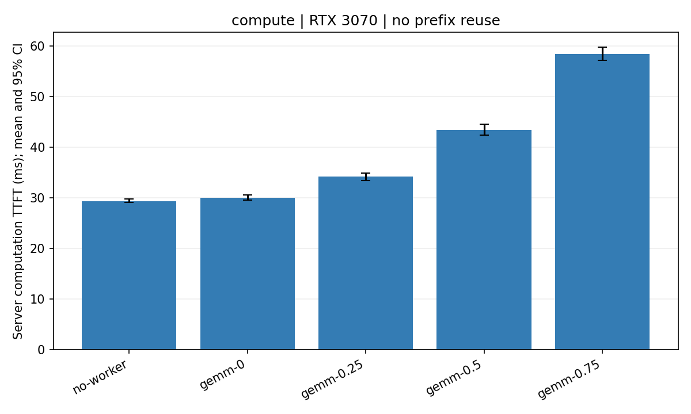
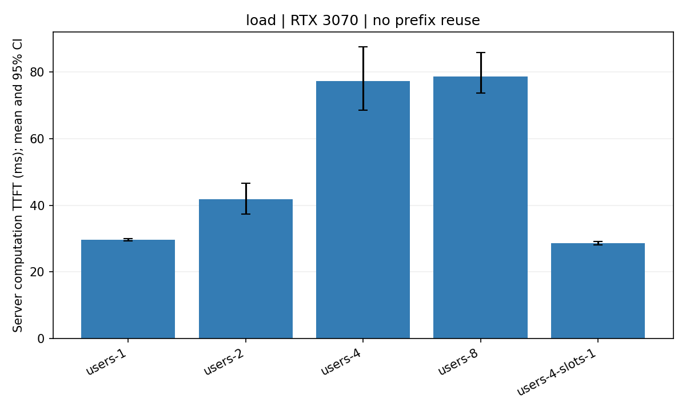
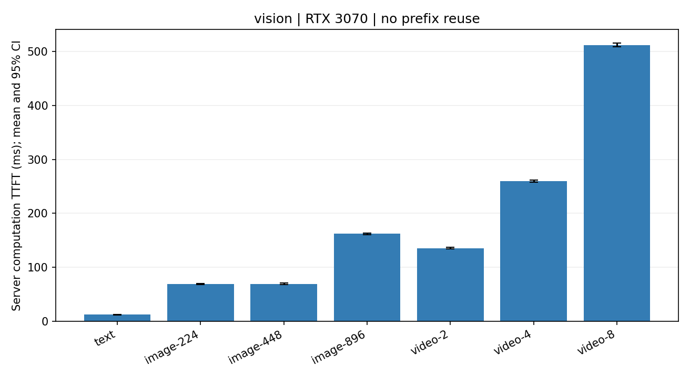
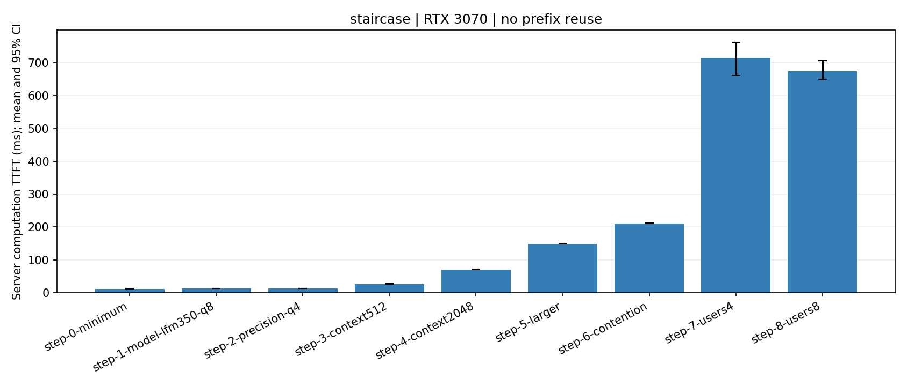

# 大模型推理首 token 纯计算时延实测报告

<!-- CURRENT:START -->
**最新完成**：累计68个配置、3264条正式测量（每配置48条），已补Qwen与MiniCPM-V及真实ERQA具身推理。ERQA单帧MiniCPM-V-4：**124.62ms**，18/48答对，46/48不超过140ms；MiniCPM-o2.6：156.56ms，20/48答对。**时延达标不等于具身能力可用；未测试机器人动作控制。** [具身报告](embodied-erqa-zh.md)。
<!-- CURRENT:END -->

日期：2026-10-13（上海时间）。主表统一采用模型运行时内部计算计时，移除通信与 Testbed 分段相加口径。主体阶段为 **9 个完整 MiniCPM-o 2.6 配置 × 48 条 = 432 条**，加原小模型 **46 × 48 = 2208 条**，小计 **55 个配置、2640 条正式请求**。[主体验收](../results/compute_only/validation.json)。后续Qwen/MiniCPM-V另9档、ERQA另4档见补测章节；全项目累计68档、3264条正式样本，另保留预热与预试验。历史结果单列，不计入本轮受控样本数。

MiniCPM 的 140 ms 目标指 **首 token 计算 TTFT**。完整视觉+语言模型的一帧合成颜色问答在明确单字母指令下为 **140.25 ms**，严格答对 **48/48**；更短但指令服从较差的原提示词为 136.92 ms，不能只按速度推荐。真实 StreamingBench 单帧、短提示词、混合 Q8 视觉组件约 **147.84 ms**。两者输入、任务不同，不能互换。所有 MiniCPM 请求都重新执行视觉编码与语言模型，没有拆为两段部署或复用视觉特征。

## 计时边界和复现条件

主指标为 llama.cpp 的 `timings.prompt_ms`：从服务端槽位开始处理输入，到首次采样 token 完成。当前 b11577 源码确认，视觉编码和语言 prefill 均在该计时区间；第一个 token 从最终 prefill logits 采样，不另加一次完整 decode。它是运行时执行的墙钟时延，包含执行期间的 CPU/GPU 调度、同步及模型内部处理，**不是纯 CUDA 内核用时之和**。不含 HTTP 往返、槽位之前的排队、权重加载、客户端 JPEG 准备及视频解码/采帧；部分输入解析也在计时外。并发时仍可能包含批处理和其他执行等待，不能视为每请求独占 GPU 的 FLOP 耗时。

完整答案计算辅助指标为 `prompt_ms + predicted_ms`；用户目标只依据首 token。原客户端 HTTP 计时及原始数据保留在[旧口径报告](request-latency-archive-zh.md)和原始 JSONL，不混入本版主表。源码依据：[槽位处理与首 token](https://github.com/ggml-org/llama.cpp/blob/b11577/tools/server/server-context.cpp)、[计时状态](https://github.com/ggml-org/llama.cpp/blob/b11577/tools/server/server-common.h)。历史 b11516 同类原生 `prompt_ms` 单列，运行时/后端不同，不能把新旧差异全部归因量化。

RTX 3070 8 GB，i5-13600K，约 32 GiB RAM，Windows 11；本次 b11577 CUDA 12.4。显卡既有功率上限 154 W，本实验未修改功率或频率。新 MiniCPM 所有语言层和视觉编码器实际使用 CUDA，单槽 4096 context，batch 2048、ubatch 512，4 CPU 线程（8线程档单列）；语言权重统一原作者 Q4_K_M。每配置两块各 24 条，原8档的块内配置顺序重新随机；严格颜色指令档为发现输出截断后另做两块补测，未随机夹入原8档。每块每配置另做 8 条不重叠预热。预试验 ID 64–71、正式 0–47、预热 112–119，温度 0、种子 20261013、`cache_prompt=false`，实测 `cache_n=0`。新 MiniCPM 允许 EOS、最多 4 token；原小模型固定生成 32 token。故生成结束耗时不能跨输出预算直接比较。

均值 CI 为固定种子 2000 次 bootstrap；并发主表按完整请求波次重采样。少数块/少数波次不足以估计长期系统漂移，p95 也仅是样本分位数。所有正式尝试均保留，未按时延筛样。量化的质量影响用同一 48 题配对小样本检查，不能当完整精度评测。

## MiniCPM-o 2.6：完整模型和 140 ms 目标

| 配置 | 输入 token 均值 | 首 token 计算均值 ms | 95% CI ms | p95 ms | 有效/尝试 | 生成结束计算均值 ms | 严格单字母正确/总数 |
|---|---:|---:|---:|---:|---:|---:|---:|
| F16视觉 / 448面积预算 / 标准词 / 1帧 | 322.02 | **390.98** | 389.31–392.80 | 397.62 | 48/48 | 405.31 | 39/48 |
| F16视觉 / 336 / 标准词 / 1帧 | 190.02 | **162.07** | 160.63–163.57 | 172.85 | 48/48 | 176.46 | 38/48 |
| F16视觉 / 336 / 短词 / 1帧 | 146.04 | **149.65** | 148.32–150.95 | 157.48 | 48/48 | 184.87 | 14/48 |
| 混合Q8视觉 / 336 / 短词 / 1帧 | 146.04 | **147.84** | 146.51–149.18 | 157.46 | 48/48 | 183.29 | 13/48 |
| 混合Q4视觉 / 336 / 短词 / 1帧 | 146.04 | **146.78** | 145.55–148.08 | 154.80 | 48/48 | 181.53 | 15/48 |
| 混合Q4视觉 / 336 / 短词 / 8线程 | 146.04 | **149.26** | 148.09–150.47 | 157.76 | 48/48 | 184.83 | 15/48 |
| 混合Q8视觉 / 224 / 颜色问答 / 1帧 | 108.00 | **136.92** | 136.51–137.35 | 139.12 | 48/48 | 166.01 | 21/48 |
| 混合Q8视觉 / 336 / 短词 / 4帧 | 344.04 | **482.79** | 481.55–484.09 | 490.63 | 48/48 | 517.26 | 18/48 |
| 混合Q8视觉 / 224 / 颜色问答 / 严格指令 | 118.00 | **140.25** | 139.95–140.56 | 141.78 | 48/48 | 154.60 | 48/48 |

前 6 档及第8档四帧使用同一组 StreamingBench 问题，单帧使用问题时刻最后一帧，四帧使用对应四帧。分辨率列为 **面积上限的平方根**，不是强制正方形；保持宽高比并向下对齐 28，例如宽屏图像的 336 档通常为 448×252。模型处理器的缩放/切片导致视觉 token 数可能不随面积连续减少，实际总输入 token 如表所示。

颜色任务为确定性生成的 224×224 单色矩形场景，位置、颜色变化，原提示词 `Color? A red B blue C green D yellow. Letter:`；严格档再加 `Reply with exactly one letter, no other text.`。它验证完整视觉路径的低时延，不能代表视频理解质量或复杂真实任务达到 140 ms。真实问答短词档仅删去冗余系统说明，保留问题和全部选项。

正确率列采用严格A–D单字母解析（允许句点），额外解释或未完成文本计错。因此该列同时反映答题正确与格式服从，不能把紧凑提示词的格式失败全解释为视觉能力下降。原颜色短词有26/48条只生成 `The color of the`，4 token达到上限；这些TTFT仍有效，但未完成答案。短词真实问答也常输出字母加解释。本表“生成结束计算”是到EOS或4 token上限的耗时，**输出截断时不是完整语义答案耗时**。严格颜色补测48条全部输出单字母并EOS结束。汇总CSV另存开头选项答对数和达到输出预算数，不隐藏格式失败。

低精度方案从原 F16 视觉组件量化得到混合 Q8_0 或 Q4_K_M，语言模型仍为 Q4_K_M。分别有 27/455、163/455 张量发生量化 fallback；实际文件平均约 11.44、10.15 BPW，**不是整模型均匀 8 bit / 4 bit**。没有把 Q4 语言权重再次量化成 Q2 并宣称等同原始 Q2。量化组件缩小显存占用，但本次真实短词档的时延收益较小，短提示词与输入切片变化贡献更大。[权重与派生哈希](../data/minicpm-artifacts.json)、[逐请求数据](../results/minicpm_native/requests.jsonl)、[GPU 后端证据](../results/minicpm_native/native-q8-compact-backend.json)。

## 模型参数量与量化

短文本模型比较观察最低为 **smol500-q8，12.45 ms**，作为本轮文本因素与阶梯的基线选择。它是已测候选的观察最低，非全局最优。

| 配置 | 输入 token 均值 | 首 token 计算均值 ms | 95% CI ms | p95 ms | 有效/尝试 |
|---|---:|---:|---:|---:|---:|
| lfm350-q4 | 93.27 | **12.72** | 12.27–13.16 | 15.66 | 48/48 |
| lfm350-q8 | 93.27 | **12.81** | 12.37–13.26 | 15.90 | 48/48 |
| lfm350-f16 | 93.27 | **12.57** | 12.21–12.94 | 15.08 | 48/48 |
| lfm1200-q4 | 93.27 | **17.25** | 17.06–17.45 | 18.28 | 48/48 |
| smol500-q8 | 94.19 | **12.45** | 11.97–12.93 | 15.31 | 48/48 |

LFM2 350M 与 1.2B 为同系列；跨 SmolVLM2 比较同时改变架构、tokenizer、模板，不能只归因参数量。新增 MiniCPM-o 2.6 是用户指定的额外较大模型，超过初始“优先 7B 以下”范围；不把它混入同参数量比较。LFM2 为自定义开放权重许可证，SmolVLM2 为 Apache-2.0。

## 固定长文本的精度对照

| 配置 | 输入 token 均值 | 首 token 计算均值 ms | 95% CI ms | p95 ms | 有效/尝试 |
|---|---:|---:|---:|---:|---:|
| lfm350-q4 | 2072.12 | **69.87** | 69.36–70.38 | 72.87 | 48/48 |
| lfm350-q8 | 2072.12 | **67.53** | 67.04–68.05 | 70.84 | 48/48 |
| lfm350-f16 | 2072.12 | **69.26** | 68.86–69.67 | 71.90 | 48/48 |

同一 LFM2-350M、同一批输入，2048 请求上下文预算。本次没有证据表明更低位宽必然降低 prefill / TTFT；请结合配对差值 CI。

## 文本长度和数据集

| 配置 | 输入 token 均值 | 首 token 计算均值 ms | 95% CI ms | p95 ms | 有效/尝试 |
|---|---:|---:|---:|---:|---:|
| squad-total-128 | 128.00 | **12.82** | 12.52–13.15 | 15.66 | 48/48 |
| squad-total-512 | 512.00 | **21.29** | 21.19–21.40 | 21.93 | 48/48 |
| squad-total-1024 | 1024.00 | **42.51** | 42.35–42.68 | 43.43 | 48/48 |
| squad-total-2048 | 2048.00 | **89.36** | 89.17–89.57 | 90.66 | 48/48 |
| synthetic-total-128 | 128.00 | **12.72** | 12.46–13.01 | 15.05 | 48/48 |
| synthetic-total-1024 | 1024.00 | **40.79** | 40.64–40.94 | 41.75 | 48/48 |

这些档位为包括模板的**实际总输入 token 数**，逐请求核验精确匹配。等长 SQuAD 与合成文本对照关注内容差异；原 SQuAD 被裁剪/重复，不作为标准准确率评测。原 inputs 阶段 token ID 转文本再编码导致部分空格合并，名义预算不等长；旧记录及实际 token 数保留在汇总中，严格结论使用 inputs_exact。

## 单卡可用算力代理

| 配置 | 输入 token 均值 | 首 token 计算均值 ms | 95% CI ms | p95 ms | 有效/尝试 |
|---|---:|---:|---:|---:|---:|
| no-worker | 542.19 | **29.39** | 29.07–29.79 | 32.68 | 48/48 |
| gemm-0 | 542.19 | **30.04** | 29.52–30.62 | 33.98 | 48/48 |
| gemm-0.25 | 542.19 | **34.18** | 33.47–34.90 | 36.98 | 48/48 |
| gemm-0.5 | 542.19 | **43.48** | 42.44–44.55 | 50.21 | 48/48 |
| gemm-0.75 | 542.19 | **58.47** | 57.21–59.77 | 64.87 | 48/48 |

固定 SmolVLM2、SQuAD 和单用户。独立 CUDA FP16 2048² GEMM 进程以 40 ms 周期控制活动占空比，保留空闲驻留和无进程对照。实测活动比例约 0 / 25.5 / 50.1 / 74.8%。这只模拟资源竞争，不能称为 GPU 使用率硬限制、SM 配额或等价另一张显卡；50% 不等于算力减半。

## 多用户负载

| 配置 | 输入 token 均值 | 首 token 计算均值 ms | 95% CI ms | p95 ms | 有效/尝试 |
|---|---:|---:|---:|---:|---:|
| users-1 | 542.19 | **29.68** | 29.32–30.06 | 32.08 | 48/48 |
| users-2 | 542.19 | **41.81** | 37.36–46.57 | 57.34 | 48/48 |
| users-4 | 542.19 | **77.35** | 68.54–87.66 | 109.11 | 48/48 |
| users-8 | 542.19 | **78.74** | 73.78–85.84 | 109.88 | 48/48 |
| users-4-slots-1 | 542.19 | **28.52** | 28.01–29.04 | 33.01 | 48/48 |

多用户共享一份权重，按同步波次发出请求，主对照固定 4 槽；32 token 全部完成后发下一波。单槽档额外改变了服务容量。主表排除进入槽位之前的排队，故仅观察运行中的计算竞争，不能代表用户体验总延迟，也不能据此断言排队消失。

## 文本、图像与多帧视频任务

| 配置 | 输入 token 均值 | 首 token 计算均值 ms | 95% CI ms | p95 ms | 有效/尝试 |
|---|---:|---:|---:|---:|---:|
| text | 94.19 | **12.14** | 11.73–12.60 | 14.94 | 48/48 |
| image-224 | 153.00 | **68.62** | 67.66–69.70 | 76.21 | 48/48 |
| image-448 | 153.00 | **69.19** | 68.09–70.46 | 76.48 | 48/48 |
| image-896 | 352.00 | **161.85** | 160.40–163.39 | 172.34 | 48/48 |
| video-2 | 311.00 | **135.15** | 133.86–136.60 | 144.12 | 48/48 |
| video-4 | 599.00 | **259.68** | 257.64–261.90 | 271.69 | 48/48 |
| video-8 | 1175.00 | **512.16** | 508.99–515.46 | 530.10 | 48/48 |

固定 SmolVLM2；48 个确定性形状/运动场景。视频为按顺序输入的 2 fps 抽帧图片序列。分辨率可能受处理器缩放、切片上限约束，不预设视觉 token 线性增加。该组测任务输入开销，不是公开真实视频基准准确率；新增 MiniCPM 另用真实 StreamingBench。

## 逐项累加的计算时延阶梯

| 配置 | 输入 token 均值 | 首 token 计算均值 ms | 95% CI ms | p95 ms | 有效/尝试 |
|---|---:|---:|---:|---:|---:|
| 0：SmolVLM2 Q8，短文本单用户 | 94.19 | **12.22** | 11.82–12.64 | 15.16 | 48/48 |
| 1：仅切换 LFM2-350M Q8 | 93.27 | **13.28** | 12.83–13.76 | 16.13 | 48/48 |
| 2：仅切换 Q4_K_M | 93.27 | **13.07** | 12.63–13.52 | 15.82 | 48/48 |
| 3：上下文预算 64→512 | 540.21 | **26.48** | 25.86–27.14 | 30.91 | 48/48 |
| 4：上下文预算 512→2048 | 2072.12 | **70.74** | 70.26–71.25 | 73.23 | 48/48 |
| 5：仅切换 LFM2-1.2B Q4 | 2072.12 | **149.18** | 148.82–149.53 | 151.14 | 48/48 |
| 6：增加 50% GEMM 竞争 | 2072.12 | **210.73** | 209.80–211.59 | 216.26 | 48/48 |
| 7：并发用户 1→4 | 2072.12 | **714.70** | 663.38–761.58 | 867.43 | 48/48 |
| 8：并发用户 4→8 | 2072.12 | **674.68** | 649.62–707.18 | 869.66 | 48/48 |

独立重测起点 12.22 ms，终点 674.68 ms。均值回落次数 **2**，全部保留；阶梯是实际累计配置路径，不能通过对结果排序来伪造单调因果。配对差值见 [CSV](../results/compute_only/paired-effects.csv)。

## 其他会话：原生 MiniCPM 历史计算记录

源自“测试 MiniCPM-o 2.6 推理准确率”会话对应的公开原生结果；直接读取模型 `timings`，不用请求总耗时，也不相加任何分段网络实验。

| 原生输入 | 样本 | 首 token 计算均值 ms | p95 ms | 完整答案计算均值 ms | 正确/总数 |
|---|---:|---:|---:|---:|---:|
| single | 125 | **476.99** | 495.35 | 491.89 | 98/125 |
| four | 125 | **1573.70** | 1598.06 | 1588.68 | 100/125 |

历史环境是 b11516 / Vulkan、语言 Q4_K_M + 视觉 F16、输入面积≤448²、最多16输出 token、种子20261009。未发现明确独立预热协议，因此保留每组全部125条，并标为历史非严格热态对照；不能以新旧差值证明单一优化收益。首条分别为 737.51, 1836.15 ms；仅去首条的敏感性均值分别为 474.89, 1571.58 ms，不替换主统计。[数值原始摘录](../results/history/minicpm-native.jsonl)、[源文件与SHA256](../results/history/provenance.json)。

## 其他会话：LLaVA 与非 LLM 计算记录

LLaVA-Video-7B-Qwen2 / NF4 双重量化 / BF16计算，WSL RTX3070：已保存 48 条件×495题=23760条。计时为 CUDA 同步包围的**缓存视觉特征及共享前缀之后的语言答案调用**，含问题后缀处理、生成和文本解码；没有内部首 token 时间。下面只记录已有纯本地答案计算，明确不能充当完整视觉+语言 TTFT，亦不与 MiniCPM 拆段相加。

| 历史条件 | 样本 | 缓存后答案计算均值 ms | p95 ms |
|---|---:|---:|---:|
| text_only | 495 | 176.75 | 215.68 |
| native_center_1 | 495 | 178.63 | 214.14 |
| native_center_4 | 495 | 180.35 | 214.55 |
| uniform_16 | 495 | 422.26 | 884.97 |
| uniform_64 | 495 | 501.52 | 824.03 |

其余48条件详见[历史缓存计算汇总](../results/history/llava-cached-summary.csv)。视觉缓存与前缀构造原计时还夹带磁盘读写、哈希/准备操作，因此没有拼成所谓完整模型纯计算时间。Liquid_V1_7B 没有可核验的本地逐题计算时延；它与本报告 LiquidAI LFM2 不是同一模型。DCVC 未发现已完成的对应计算实测，这两项明确留缺。

GRACE 会话另有 CUDA 同步的编解码微基准，属于神经视频编解码计算，**不属于大模型 TTFT**：256×192，batch1，同帧串行，预热5次后20次，包含CPU/GPU拷贝；只在本节附录保留，不与LLM排序。

| 计算操作 | 样本 | 均值 ms | p95 ms |
|---|---:|---:|---:|
| encode_ms | 20 | 14.173 | 15.304 |
| decode_ms | 20 | 6.226 | 6.637 |
| entropy_encode_ms | 20 | 3.132 | 3.337 |
| entropy_decode_ms | 20 | 0.252 | 0.266 |

[历史来源与缺失项](../results/history/provenance.json)保留公开仓库固定 commit、逐文件 SHA256；未上传其他会话的私人转录、视频、权重和服务日志。

## 数据与复现

[计算汇总CSV](../results/compute_only/summary.csv)、[配对效应](../results/compute_only/paired-effects.csv)、[原小模型逐请求](../results/requests.jsonl)、[新MiniCPM逐请求](../results/minicpm_native/requests.jsonl)、[原模型清单](../data/artifacts.json)、[MiniCPM清单](../data/minicpm-artifacts.json)。运行 `python scripts/build_compute_report.py` 从已公开的数值记录重建报告和图；运行 `python scripts/run_minicpm_sweep.py --assets <本地原生素材目录>` 重测新MiniCPM。素材需由公开 StreamingBench 来源及历史原生抽帧流程准备，权重按清单下载，视觉组件按清单命令从F16派生；不分发完整数据集或权重。

单卡桌面、单版本运行时和小样本准确率限制结论外推；参数量不是FLOPs，低精度不保证降低TTFT，处理器切片会改变视觉token，硬件竞争代理不代表另一张GPU。

<!-- VLM-EXTENSION:START -->
## Qwen 与 MiniCPM-V 补测

[完整补测报告](vlm-extension-zh.md)；状态 complete，432 条正式测量。连同原实验共64配置、3072条正式测量。

| 模型 | 输入 | 有效/尝试 | 首token计算均值 ms | 95% CI ms | p95 ms | 生成结束计算均值 ms | 严格单字母正确/总数 |
|---|---|---:|---:|---:|---:|---:|---:|
| Qwen2.5-VL-3B-Instruct | 真实单帧336 | 48/48 | **109.57** | 108.79–110.31 | 114.06 | 119.05 | 36/48 |
| Qwen2.5-VL-3B-Instruct | 真实四帧336 | 48/48 | **358.18** | 356.75–359.62 | 364.67 | 367.70 | 36/48 |
| Qwen2.5-VL-3B-Instruct | 颜色单帧224严格指令 | 48/48 | **64.64** | 64.31–65.03 | 66.79 | 74.00 | 48/48 |
| Qwen2-VL-2B-Instruct | 真实单帧336 | 48/48 | **82.99** | 82.46–83.59 | 85.99 | 89.66 | 29/48 |
| Qwen2-VL-2B-Instruct | 真实四帧336 | 48/48 | **276.44** | 275.66–277.28 | 282.01 | 283.10 | 33/48 |
| Qwen2-VL-2B-Instruct | 颜色单帧224严格指令 | 48/48 | **50.04** | 49.51–50.61 | 54.12 | 56.55 | 48/48 |
| MiniCPM-V-4 | 真实单帧336 | 48/48 | **129.76** | 128.93–130.65 | 136.00 | 139.49 | 35/48 |
| MiniCPM-V-4 | 真实四帧336 | 48/48 | **429.82** | 428.42–431.40 | 436.60 | 439.14 | 37/48 |
| MiniCPM-V-4 | 颜色单帧224严格指令 | 48/48 | **115.28** | 114.87–115.68 | 117.49 | 124.69 | 48/48 |

2B实际模型为Qwen2-VL-2B，3B为Qwen2.5-VL-3B。语言Q4_K_M+视觉F16，每次完整执行。真实任务和颜色任务分列；严格格式失败、输出截断均保留。
<!-- VLM-EXTENSION:END -->

<!-- ERQA:START -->
## ERQA 具身推理补测

[完整报告](embodied-erqa-zh.md)；状态complete，192条正式样本。连同此前实测共68配置、3264条正式请求。

| 模型 / 视觉精度 | 面积预算 | 有效/尝试 | 首token均值 ms | 95% CI ms | p95 ms | 严格正确 | ≤140ms | 正确且≤140ms |
|---|---:|---:|---:|---:|---:|---:|---:|---:|
| MiniCPM-o-2.6 / 混合Q8 | 224 | 48/48 | **156.56** | 154.31–159.38 | 172.78 | 20/48 | 0/48 | 0/48 |
| MiniCPM-V-4 / F16 | 224 | 48/48 | **124.56** | 123.24–126.20 | 134.39 | 16/48 | 46/48 | 16/48 |
| MiniCPM-V-4 / F16 | 336 | 48/48 | **124.62** | 123.37–126.19 | 134.92 | 18/48 | 46/48 | 18/48 |
| Qwen2.5-VL-3B-Instruct / F16 | 336 | 48/48 | **106.61** | 104.55–108.52 | 118.49 | 16/48 | 48/48 | 16/48 |

这是具身场景理解问答，未执行机器人动作。使用固定真实ERQA题目，完整视觉+语言计算，无特征/前缀复用；低分辨率的速度须结合正确率判断。
<!-- ERQA:END -->
