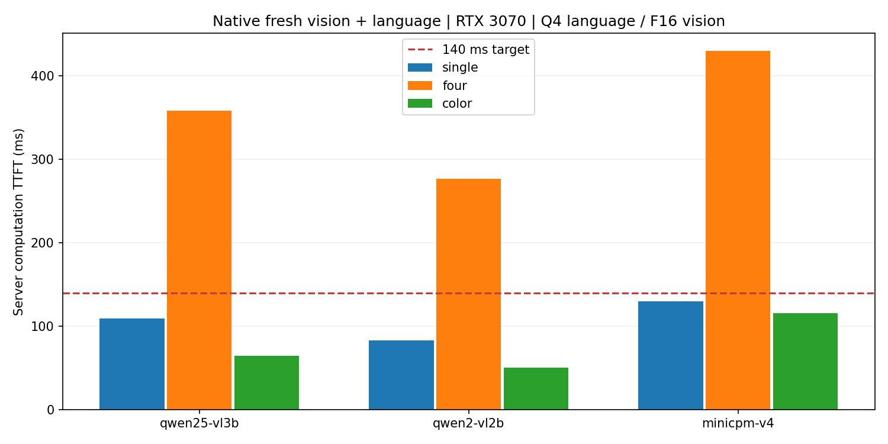

# Qwen / MiniCPM-V 完整模型计算TTFT补测

日期：2026-10-13（上海）。状态：complete；正式432条。每档48条，共9档432条。

| 模型 | 输入 | 有效/尝试 | 首token计算均值 ms | 95% CI ms | p95 ms | 生成结束计算均值 ms | 严格单字母正确/总数 |
|---|---|---:|---:|---:|---:|---:|---:|
| Qwen2.5-VL-3B-Instruct | 真实单帧336 | 48/48 | **109.57** | 108.79–110.31 | 114.06 | 119.05 | 36/48 |
| Qwen2.5-VL-3B-Instruct | 真实四帧336 | 48/48 | **358.18** | 356.75–359.62 | 364.67 | 367.70 | 36/48 |
| Qwen2.5-VL-3B-Instruct | 颜色单帧224严格指令 | 48/48 | **64.64** | 64.31–65.03 | 66.79 | 74.00 | 48/48 |
| Qwen2-VL-2B-Instruct | 真实单帧336 | 48/48 | **82.99** | 82.46–83.59 | 85.99 | 89.66 | 29/48 |
| Qwen2-VL-2B-Instruct | 真实四帧336 | 48/48 | **276.44** | 275.66–277.28 | 282.01 | 283.10 | 33/48 |
| Qwen2-VL-2B-Instruct | 颜色单帧224严格指令 | 48/48 | **50.04** | 49.51–50.61 | 54.12 | 56.55 | 48/48 |
| MiniCPM-V-4 | 真实单帧336 | 48/48 | **129.76** | 128.93–130.65 | 136.00 | 139.49 | 35/48 |
| MiniCPM-V-4 | 真实四帧336 | 48/48 | **429.82** | 428.42–431.40 | 436.60 | 439.14 | 37/48 |
| MiniCPM-V-4 | 颜色单帧224严格指令 | 48/48 | **115.28** | 114.87–115.68 | 117.49 | 124.69 | 48/48 |

语言权重均为Q4_K_M，视觉组件均为F16；每个请求重新编码图片并执行语言模型，无特征或前缀缓存。单槽4096context、batch2048/ubatch512、4线程、温度0、固定种子20261013、最多4输出token、EOS正常生效，与本次MiniCPM运行时和计时方法一致。9档按两块随机顺序测量，每块24个配对正式样本+8个独立预热；正式/预热/预试验ID分离。色彩任务与MiniCPM严格指令档使用相同生成规则、JPEG和提示词。实际输入token因模型模板、tokenizer和视觉处理器而不同，跨模型差异不能仅归因参数量。

面积预算336表示像素面积不超过336²并保留宽高比、对齐28，不是固定336×336；颜色任务224×224。真实题取自相同48个StreamingBench问题，四帧含时序上下文；不是把视觉和语言拆开计时。严格正确率要求单字母A–D（允许句点），解释/截断算格式失败；“生成结束计算”只到EOS或4token上限，截断时不能称完整答案。CSV同时保留开头选项正确数和达到输出上限数。48题准确率不代表完整模型基准排名。

命名核实：实际测试 [Qwen2.5-VL-3B-Instruct](https://huggingface.co/Qwen/Qwen2.5-VL-3B-Instruct)、[Qwen2-VL-2B-Instruct](https://huggingface.co/Qwen/Qwen2-VL-2B-Instruct)、[MiniCPM-V-4（4B）](https://huggingface.co/openbmb/MiniCPM-V-4)。2B属于Qwen2-VL，未虚构Qwen2.5-VL-2B；两个Qwen的GGUF来自ggml-org，MiniCPM-V的GGUF来自原作者OpenBMB。此处MiniCPM-V-4是为8GB显存选择的具体版本，不代表所有MiniCPM-V。

[逐请求](../results/vlm_extension/requests.jsonl)、[CSV](../results/vlm_extension/summary.csv)、[验收](../results/vlm_extension/validation.json)、[固定revision与SHA256](../data/vlm-extension-artifacts.json)。

复现：`python scripts/prepare_vlm_extension.py` 下载并校验权重；`python scripts/run_vlm_extension.py --assets <本地原生素材目录>` 测量；`python scripts/report_vlm_extension.py` 重建本页。
